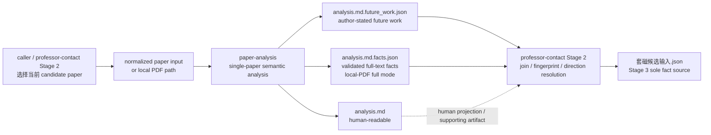

# paper-analysis

`paper-analysis` 是 ScholarWorkflow 的**单篇论文证据分析 producer**。它接受用户提供的文本、PDF、文本文件或 normalized paper-input JSON，产出基于证据的分析；它不搜索论文、不下载论文，也不拥有 Zotero 或 professor-contact 的状态机。

当前包同时面向 `opencode` 与 `codex`；下面的 Nix 安装入口目前只面向 Codex（`aarch64-darwin`）。

## 在套磁工作流中的位置



`paper-analysis` 不写 `_resolved_directions.json`、`套磁候选输入.json`、gap shortlist、套磁想法或邮件状态。这些属于 `professor-contact` 的 deterministic runner / Stage contract。

## Saved local-PDF full mode

对保存到磁盘的本地 PDF `mode: full`，一次分析调用必须完成三件套：

```text
<analysis>.md
<analysis>.md.future_work.json
<analysis>.md.facts.json
```

- `.future_work.json`：只保存作者明确提出的 future work / future direction 证据；普通 limitation 或读者推断不能升级成作者意图。
- `.facts.json`：由 deterministic `facts.py` 校验/写入，绑定当前 PDF fingerprint 与同一 analysis 的 future-work IDs；模型不得手写该 sidecar。
- 不允许为了补 facts 再跑第二次全文模型分析，也不允许从最终 Markdown 用 regex/grep 反向重建机器 facts。

Pasted text、`.txt/.md`、abstract-level normalized JSON 不承诺 local-PDF full-mode 的 facts 三件套。

## 输入边界

Zotero-aware caller 必须先在上游把元数据/摘要规范化成 `paper-analysis-input` JSON，再把文件路径传进来。`item_key` / `source` 只作为 provenance；`paper-analysis` 不凭它们打开 Zotero、MCP 或重新抓取论文。

## Nix 安装（Codex，aarch64-darwin）

除 APM 之外，本仓提供一个 Nix 安装入口，只支持 Apple Silicon macOS（`aarch64-darwin`）+ Codex。Nix 激活后不需要再跑 APM，也不需要 `uv`、PEP 723 自举或宿主 Python：技能里 4 个 helper、`pdfx` 质量 CLI 和 OCR wrapper 都是安装树中的固定入口。

`.apm/skills/paper-analysis/` 与 `.apm/agents/paper-analysis.agent.md` 仍是唯一业务来源；Nix 层只做构建时的入口转换和固定 launcher，不维护第二份正文。

### 固定版本

| 输入 | revision |
|---|---|
| nixpkgs | `6510408d147d8c5e6d76043e899e9251756f6a75` |
| agent-env-nix | `2158e933aab6c845ae1ceb1228458d624f8777d5` |
| base-skills（vision-tools 与 vision-glance app） | `3ab2ac188e625b8a8ae37b5fa318c579787c3d1e` |
| pdf-processing-core（`nix/pdfx.nix` 的 python 与 pdfx） | `3444dca0e0b84f46d1839ab5c707afa78e23d3a7` |

base-skills 自己的 nixpkgs 与 agent-env-nix 跟随本仓统一输入；`flake.lock` 记录以上全部 revision。

### 安装

```bash
nix build github:ScholarWorkflow/paper-analysis#packages.aarch64-darwin.paper-analysis-project \
  --out-link "$PWD/project-env"
CODEX_HOME="$PWD/codex-home" "$PWD/project-env/bin/agent-env" apply --project /absolute/path/to/consumer
```

安装是真实复制，不是 store view。安装后：

- `<consumer>/.agents/skills/paper-analysis/`：完整技能、原有 4 个 `scripts/*.py`、6 个 `bin/*` 入口（`paper-input`、`pdf-runtime`、`future-work`、`facts`、`pdfx`、`vision-glance`）
- `<consumer>/.agents/skills/vision-tools/`：直接依赖 vision-tools
- `<consumer>/.codex/agents/paper-analysis.toml`：原生 `paper-analysis` 角色
- `<consumer>/.agent-env-nix/`：安装状态与 GC root

项目需要先被 Codex 信任；`agent-env` 不修改信任设置。

### 覆盖与移除

- 重新 `apply` 会覆盖受管的 `paper-analysis` 与 `vision-tools` 叶子（含其中的手改），其他来源的同级 skill/agent 保留。
- `agent-env remove --project /absolute/path/to/consumer` 移除本包受管资源。
- 配置或安装冲突不静默覆盖：修好原因后按同一条 `apply` 重跑。

### OCR 外部前提

`bin/vision-glance` 只转发到 base-skills 固定的 `vision-glance` app，不带模型、端点或凭据。真实 OCR 仍需要：

- 视觉模型配置：`VISION_ENV_FILE` 显式指定的 env 文件，或 `~/.config/agent-vision-toolkit/env`，字段为 `VISION_API_KEY`、`VISION_BASE_URL`、`VISION_MODEL`。
- 配额与授权：用量状态默认 `~/.config/agent-vision-toolkit/state.json`，可用 `VISION_STATE_FILE` 指向本次可写状态；付费兜底受 `VISION_DAILY_BUDGET_USD` 限制。
- 没有配置或授权时保留原有询问/报错路径，不降级成伪 OCR；密钥不进入 Nix store 或仓库。

当前只验证了安装、四个 helper 的最小动作和 OCR wrapper 接线，没有真实 OCR 运行记录。

### 已知限制

- 只支持 `aarch64-darwin` + Codex；没有 Linux、其他 macOS 架构或 OpenCode 的 Nix 安装。
- 源层编排问题：基线角色的「交互与运行时兼容约定」与 Step 3 仍含 `ALL_TOOLS` 工具发现前置，与现行 Project Consensus 的 Codex 委派约定冲突。它属于唯一 skill/agent 源，由源负责人另行处理并保留 OpenCode 分支；Nix 层只做等价入口绑定，不修改也不宣称已解决。因此本轮安装结果不代表 full 编排已符合现行约定。
- 不恢复已撤销的 linker、CLI backfill、map、dedup，也不迁移 Zotero/browser 业务链。
- APM、uv、PEP 723 与 OpenCode 原件保持原样，供原有路径继续使用。

## 开发参考

- [paper-analysis caller contract](.apm/skills/paper-analysis/SKILL.md)
- `scripts/paper_input.py` — normalized input validator/canonicalizer
- `scripts/future_work.py` — future-work candidate/evidence validation
- `scripts/facts.py` — structured facts validation/finalization

对套磁 workflow 的方向归属、candidate union、Stage 2 cache/resolution、Stage 3 唯一事实源等规则，应回到 `ScholarWorkflow/professor-contact` 当前 workflow reference，而不是在本仓重复定义第二套状态机。